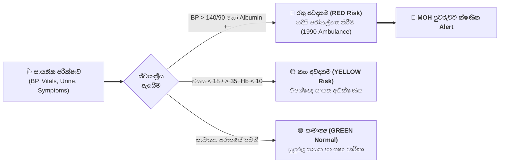
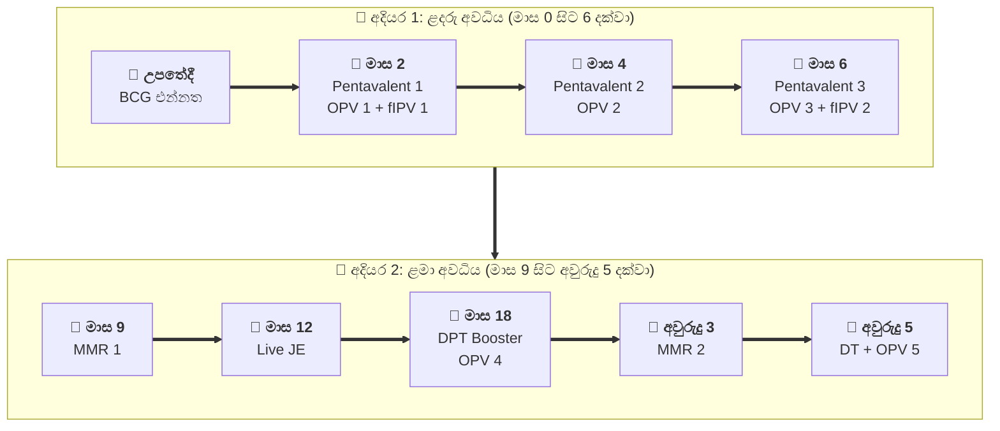

# පරිශීලක මෙහෙයුම් අත්පොත: දරුනැලි (Daruneli)
### ජාතික මාතෘ සහ ළමා සෞඛ්‍ය ඩිජිටල් තොරතුරු පද්ධතිය (Maternal & Child Health Information System)

| ලේඛන විස්තරය (Document Property) | අගය / තොරතුරු (Value / Details) |
| :--- | :--- |
| **පද්ධතියේ නම (System Name)** | **දරුනැලි (Daruneli) • Powered by Bitgard Pvt Ltd** |
| **ලේඛන වර්ගය (Document Type)** | සම්පූර්ණ පද්ධති පරිශීලක මෙහෙයුම් අත්පොත (Comprehensive User Manual) |
| **අනුවාදය (Version)** | 1.0 (වලස්මුල්ල නියමු සහ ජාතික යෙදවීම් ප්‍රකාශනය / Walasmulla Pilot Edition) |
| **දිනය (Date)** | 24/11/2026 |
| **ඉලක්කගත පාර්ශ්වකරුවන් (Target Audience)** | පවුල් සෞඛ්‍ය සේවා නිලධාරිනියන් (PHM), සෞඛ්‍ය වෛද්‍ය නිලධාරීන් (MOH), මහජන සෞඛ්‍ය හෙද සොයුරියන් (PHNS), සහ ගර්භණී මව්වරුන් |
| **තත්ත්වය (Status)** | Completed |

---

## පටුන (Table of Contents)
1. [පද්ධති හැඳින්වීම සහ ගෘහ නිර්මාණ සැකැස්ම (System Overview)](#1-පද්ධති-හැඳින්වීම-සහ-ගෘහ-නිර්මාණ-සැකැස්ම-system-overview)
2. [ක්ෂේත්‍ර PHM ජංගම යෙදුම පරිශීලන මාර්ගෝපදේශය (Mobile App Manual)](#2-ක්ෂේත්‍ර-phm-ජංගම-යෙදුම-පරිශීලන-මාර්ගෝපදේශය-mobile-app-manual)
   - 2.1 [යෙදුම ස්ථාපනය සහ ප්‍රථම පිවිසුම (App Login & Setup)](#21-යෙදුම-ස්ථාපනය-සහ-ප්‍රථම-පිවිසුම)
   - 2.2 [නොබැඳි දත්ත සමමුහුර්තකරණය (Offline-First Sync)](#22-නොබැඳි-දත්ත-සමමුහුර්තකරණය-සහ-තත්ත්ව-දර්ශකය)
   - 2.3 [නව පවුල් සහ මව්වරුන් ලියාපදිංචිය (Mother Registration)](#23-නව-පවුල්-සහ-මව්වරුන්-ලියාපදිංචි-කිරීම)
   - 2.4 [පූර්ව ප්‍රසව සායනික සහ ගෘහ චාරිකා සටහන් (Antenatal Visits)](#24-පූර්ව-ප්‍රසව-සායනික-සහ-ගෘහ-චාරිකා-සටහන්)
   - 2.5 [ළමා ලියාපදිංචිය, WHO ප්‍රස්ථාර සහ පෝෂණ අධීක්ෂණය (Child Growth)](#25-ළමා-ලියාපදිංචිය-who-ප්‍රස්ථාර-සහ-පෝෂණ-අධීක්ෂණය)
   - 2.6 [EPI එන්නත් කාලසටහන කළමනාකරණය (Immunization Tracker)](#26-epi-එන්නත්-කාලසටහන-කළමනාකරණය)
   - 2.7 [ඩිජිටල් QR ස්කෑනරය භාවිතය (Digital QR Scanner)](#27-ඩිජිටල්-qr-ස්කෑනරය-භාවිතය)
   - 2.8 [H509 මාසික වාර්තාව ස්වයංක්‍රීයව සැකසීම (H509 Monthly Returns)](#28-h509-මාසික-වාර්තාව-ස්වයංක්‍රීයව-සැකසීම-සහ-pdf-අපනයනය)
3. [MOH පරිපාලන සහ සායනික උපකරණ පුවරුව (Web Dashboard Manual)](#3-moh-පරිපාලන-සහ-සායනික-උපකරණ-පුවරුව-web-dashboard-manual)
   - 3.1 [ආරක්ෂිත පිවිසුම සහ භූමිකා පාලනය (Role-Based Access Control)](#31-ආරක්ෂිත-පිවිසුම-සහ-භූමිකා-පාලනය)
   - 3.2 [විධායක දළ විශ්ලේෂණ පුවරුව (Executive Division Overview)](#32-විධායක-දළ-විශ්ලේෂණ-පුවරුව)
   - 3.3 [අධි අවදානම් හදිසි පෝලිම (Escalation Radar & Triage)](#33-අධි-අවදානම්-හදිසි-පෝලිම-escalation-radar)
   - 3.4 [H509 මාසික වාර්තා සමාලෝචනය (Reports Review)](#34-h509-මාසික-වාර්තා-සමාලෝචනය)
   - 3.5 [ක්ෂේත්‍ර අධීක්ෂණය සහ කාලසටහන් (Supervision & Timetables)](#35-ක්ෂේත්‍ර-අධීක්ෂණය-සහ-කාලසටහන්)
   - 3.6 [PHM කොට්ඨාස සහ කාර්ය මණ්ඩල කළමනාකරණය (Areas & Staff)](#36-phm-කොට්ඨාස-සහ-කාර්ය-මණ්ඩල-කළමනාකරණය)
4. [මව්වරුන්ගේ ඩිජිටල් සහායක ද්වාරය (Mother Companion Portal Manual)](#4-මව්වරුන්ගේ-ඩිජිටල්-සහායක-ද්වාරය-mother-companion-portal-manual)
   - 4.1 [ආරාධනා කේතය (Invite Code) හෝ PIN මගින් පිවිසීම](#41-ආරාධනා-කේතය-invite-code-හෝ-pin-මගින්-පිවිසීම)
   - 4.2 [ගර්භණී සති ප්‍රගතිය (POG Tracker)](#42-ගර්භණී-සති-ප්‍රගතිය-සහ-දින-දර්ශනය)
   - 4.3 [කාඩිෆ් කලල චලන ගණකය (Cardiff Kick Counter)](#43-කාඩිෆ්-කලල-චලන-ගණකය-cardiff-kick-counter)
   - 4.4 [ඩිජිටල් සායනික හැඳුනුම්පත (Digital Clinic Pass)](#44-ඩිජිටල්-සායනික-හැඳුනුම්පත-digital-clinic-pass)
5. [දත්ත ආරක්ෂණය, උපස්ථ සහ දෝෂ නිරාකරණය (Security & Troubleshooting)](#5-දත්ත-ආරක්ෂණය-උපස්ථ-සහ-දෝෂ-නිරාකරණය-security--troubleshooting)

---

## 1. පද්ධති හැඳින්වීම සහ ගෘහ නිර්මාණ සැකැස්ම (System Overview)

"දරුනැලි (Daruneli)" පද්ධතිය යනු ශ්‍රී ලංකාවේ ප්‍රාථමික මාතෘ සහ ළමා සෞඛ්‍ය (Maternal and Child Health - MCH) සේවාවන් ඩිජිටල්කරණය කිරීම සඳහා නිර්මාණය කරන ලද නවීන, ත්‍රිත්ව-ස්ථර තොරතුරු පද්ධතියකි. පවුල් සෞඛ්‍ය කාර්යාංශයේ (Family Health Bureau - FHB) මාර්ගෝපදේශ සහ ලෝක සෞඛ්‍ය සංවිධානයේ (WHO) ප්‍රමිතීන්ට අනුකූලව මෙම පද්ධතිය ගොඩනගා ඇත.

```mermaid
flowchart LR
    subgraph MobileCol ["📱 1. ක්ෂේත්‍ර ජංගම පද්ධතිය (PHM Mobile)"]
        direction TB
        PHM["👩‍⚕️ <b>පවුල් සෞඛ්‍ය සේවා නිලධාරිනිය</b><br/>(Field PHM Officer)"]
        App["📱 <b>Daruneli Mobile App</b><br/>(React Native Expo Core)"]
        OfflineDB[("💾 <b>100% Offline SQLite</b><br/>(Local Storage Gate)")]
        QRScan["📷 <b>Digital Clinic Pass Scanner</b><br/>(Camera QR Module)"]
        PHM ==> App
        App --> OfflineDB
        App --> QRScan
    end

    subgraph CloudCol ["🛡️ 2. ආරක්ෂණ සහ වලාකුළු මධ්‍යස්ථානය (Security Hub)"]
        direction TB
        Sync["🔄 <b>Sync & Conflict Resolver</b><br/>(Background Auto-Sync)"]
        Zod["🔒 <b>Zod Schema Gate</b><br/>(100% Validation Layer)"]
        Prisma["⚡ <b>Prisma ORM & HMAC Auth</b><br/>(Type-Safe Security)"]
        CloudDB[("🗄️ <b>PostgreSQL Cloud DB</b><br/>(Supabase Enterprise)")]
        Sync ==> Zod ==> Prisma ==> CloudDB
    end

    subgraph WebCol ["💻 3. අධීක්ෂණ සහ මව්වරුන්ගේ ද්වාර (Web Portals)"]
        direction TB
        Dash["💻 <b>MOH Supervision Dashboard</b><br/>(Next.js 14 Web Portal)"]
        Doctor["👨‍⚕️ <b>MOH වෛද්‍යවරුන් / PHNS</b><br/>(Clinical Supervision)"]
        MotherPortal["📱 <b>Mother Companion Portal</b><br/>(Progressive Web App)"]
        Mother["🤰 <b>ගර්භණී මව්වරුන් / භාරකරුවන්</b><br/>(Kick Tracker / Pass)"]
        Dash ==> Doctor
        MotherPortal ==> Mother
    end

    App <===>|නොබැඳි ද්වි-දිශා Sync| Sync
    CloudDB <===>|තත්‍ය කාලීන සායනික දත්ත| Dash
    CloudDB <===>|ගුප්තකේතන සැසි (Sessions)| MotherPortal
```

### පද්ධතියේ ප්‍රධාන සංරචක 3:
1. **ක්ෂේත්‍ර PHM ජංගම යෙදුම (Offline-First Mobile App):** අන්තර්ජාල පහසුකම් නොමැති දුරස්ථ ගම්මානවලදී පවා පවුල්, මව්වරුන්, සායනික සටහන්, ළමා වර්ධන දත්ත සහ එන්නත් තොරතුරු කිසිදු බාධාවකින් තොරව සටහන් කිරීම.
2. **MOH පරිපාලන සහ සායනික වෙබ් පුවරුව (Supervision Dashboard):** කොට්ඨාසයේ සියලුම PHM වසම්වල තොරතුරු තත්‍ය කාලීනව අධීක්ෂණය, රතු/කහ අවදානම් තත්ත්වයන් කල්තියා හඳුනාගැනීම සහ H509 මාසික වාර්තා පරීක්ෂාව.
3. **මව්වරුන්ගේ ඩිජිටල් සහායක ද්වාරය (Mother Companion Portal PWA):** මව්වරුන්ට තම ගර්භණී කාලසටහන බැලීම, දෛනික කලල චලන ගණනය (Cardiff Kick Chart) සහ සායනික පොත නොමැති විට පෙන්විය හැකි Digital QR Clinic Pass පහසුකම.

---

## 2. ක්ෂේත්‍ර PHM ජංගම යෙදුම පරිශීලන මාර්ගෝපදේශය (Mobile App Manual)

### 2.1 යෙදුම ස්ථාපනය සහ ප්‍රථම පිවිසුම
1. ඔබගේ ඇන්ඩ්‍රොයිඩ් දුරකථනයේ හෝ ටැබ්ලට් පරිගණකයේ `Daruneli Mobile` යෙදුම විවෘත කරන්න.
2. පිවිසුම් තිරයේ (Login Screen) ඔබගේ **MOH නිල ඊමේල් ලිපිනය** (උදා: `sunethra.phm@health.gov.lk`) සහ රහස්පදය ඇතුළත් කරන්න.
3. ප්‍රථම වරට පිවිසීමේදී ඔබගේ PHM කොට්ඨාසයට අදාළ මූලික දත්ත (Master Data) දුරකථනයට බාගත වන තෙක් තත්පර කිහිපයක් රැඳී සිටින්න.

> [!TIP]
> **නොබැඳිව ක්‍රියාකිරීම:** ප්‍රථම පිවිසුමෙන් පසු අන්තර්ජාල සම්බන්ධතාවය විසන්ධි වුවද යෙදුමෙන් පිටවීම (Sign Out) සිදු නොකරන්න. අන්තර්ජාලය නොමැතිව වුවද ඔබට දින ගණනාවක් සම්පූර්ණ පද්ධතියම භාවිතා කළ හැක.

---

### 2.2 නොබැඳි දත්ත සමමුහුර්තකරණය සහ තත්ත්ව දර්ශකය

යෙදුමේ ඉහළ දකුණු කෙළවරේ **සමමුහුර්තකරණ තත්ත්ව දර්ශකය (Sync Status Pill)** දිස්වේ:

| දර්ශකයේ වර්ණය / අයිකනය | තත්ත්වය (Status) | අර්ථය සහ ගතයුතු ක්‍රියාමාර්ගය |
| :---: | :--- | :--- |
| 🟢 **කොළ පැහැය (Online & Synced)** | **සමමුහුර්ත වී ඇත** | සියලුම දත්ත මධ්‍යම සේවාදායකය (Cloud Server) සමග යාවත්කාලීන වී ඇත. |
| 🟡 **කහ පැහැය (Pending Sync)** | **යැවීමට නියමිත දත්ත ඇත** | ඔබ නොබැඳිව ඇතුළත් කළ දත්ත දුරකථනයේ සුරක්ෂිතව ඇති අතර, අන්තර්ජාලය ලැබුණු වහාම පසුබිමෙන් ස්වයංක්‍රීයව සමමුහුර්ත වේ. |
| 🔴 **රතු පැහැය (Offline Mode)** | **නොබැඳි ප්‍රකාරය** | දුරකථනය අන්තර්ජාලයට සම්බන්ධ වී නොමැත. බිය නොවී සුපුරුදු පරිදි සායනික දත්ත ඇතුළත් කරන්න. |

---

### 2.3 නව පවුල් සහ මව්වරුන් ලියාපදිංචි කිරීම

```
[ප්‍රධාන පුවරුව] ➔ [Mothers ටැබය] ➔ [+ ලියාපදිංචි කරන්න (Register New)]
```

1. **සුදුසුකම්ලත් පවුල් අංකය (Eligible Family No):** `EF/WAL/001` ආදී නිල අංකය ඇතුළත් කරන්න.
2. **ග්‍රාම නිලධාරී වසම (GN Division):** වලස්මුල්ල නගරය, බෝවල, ඔමාර, මැදගංගොඩ ආදී ලැයිස්තුවෙන් තෝරන්න.
3. **මවගේ මූලික තොරතුරු:**
   - සම්පූර්ණ නම (Full Name)
   - ජාතික හැඳුනුම්පත් අංකය (NIC - උදා: `917654321V` හෝ `199176543210`)
   - උපන් දිනය (DOB - `DD/MM/YYYY`)
   - රුධිර ගණය (Blood Group - `A+`, `B+`, `O+`, ආදී)
   - ස්වාමිපුරුෂයාගේ නම සහ හදිසි ඇමතුම් අංකය
4. **පූර්ව සෞඛ්‍ය සහ ප්‍රසව ඉතිහාසය (Medical & Obstetric Risk History):**
   - දීර්ඝකාලීන රෝග (අධික රුධිර පීඩනය, දියවැඩියාව, හෘද රෝග, තයිරොයිඩ්)
   - පෙර ගබ්සාවීම් (Miscarriages), මළදරු උපත් (Stillbirths) හෝ සිසේරියන් සැත්කම් (C-Sections)
5. **සුරකින්න (Save):** පද්ධතිය ක්ෂණිකව මවට අදාළ **ඩිජිටල් QR ටෝකනය (Digital Pass Token)** සහ ආරාධනා කේතය (Invite Code) ජනනය කරයි.

---

### 2.4 පූර්ව ප්‍රසව සායනික සහ ගෘහ චාරිකා සටහන්

සායනයකදී හෝ නිවසට ගිය අවස්ථාවකදී මවගේ නම මත ක්ලික් කර **"නව සායන සටහන (New Antenatal Visit)"** තෝරන්න:

1. **ගර්භණී කාලය (POG):** අවසන් ඔසප් දිනය (LRMP) අනුව ගර්භණී සති සහ දින ගණන ස්වයංක්‍රීයව ගණනය වේ.
2. **ජීව දත්ත (Vitals):**
   - රුධිර පීඩනය (Blood Pressure - උදා: `120/80` mmHg)
   - බර (Weight in kg)
   - ගර්භාෂ උස (Symphysio-Fundal Height - SFH cm)
   - කලල හෘද ස්පන්දනය (Fetal Heart Sound - Present / Absent)
   - මුත්‍රා ඇල්බියුමින් (Urine Albumin - Nil / Trace / + / ++)
3. **ස්වයංක්‍රීය අවදානම් වර්ගීකරණය (Automated Maternal Risk Triaging):**
   - 🔴 **රතු අවදානම (RED High Risk):** BP > 140/90, මුත්‍රා ඇල්බියුමින් ++, දැඩි හිසරදය හෝ පෙනීමේ අපහැදිලිතා. පද්ධතිය ක්ෂණිකව MOH වෛද්‍යවරයාගේ පුවරුවට හදිසි නිවේදනයක් (Critical Alert) යොමු කරයි.
   - 🟡 **කහ අවදානම (YELLOW Moderate Risk):** මවගේ වයස අවුරුදු 18 ට අඩු හෝ 35 ට වැඩි වීම, රක්තහීනතාවය (Hb < 10 g/dL), බර වැඩිවීම අඩුවීම.
   - 🟢 **කොළ (GREEN Normal):** සාමාන්‍ය ප්‍රගතිය.



---

### 2.5 ළමා ලියාපදිංචිය, WHO ප්‍රස්ථාර සහ පෝෂණ අධීක්ෂණය

```
[Children ටැබය] ➔ [දරුවා තෝරන්න] ➔ [බර සහ උස සටහන් කිරීම]
```

1. **උපත් තොරතුරු:** උපන් දිනය, උපත් බර (Birth Weight in kg), උපන් රෝහල සහ ස්ත්‍රී/පුරුෂ භාවය.
2. **මාසික බර කිරුම් සටහන:** දරුවාගේ බර ඇතුළත් කළ වහාම ලෝක සෞඛ්‍ය සංවිධානයේ (WHO) නිල ප්‍රමිතීන් අනුව **Z-Score (Weight-for-Age)** ස්වයංක්‍රීයව ගණනය වේ:
   - 🟢 **සාමාන්‍ය (Green):** -2 SD සහ +2 SD අතර (නිරෝගී වර්ධනය).
   - 🟡 **මධ්‍යස්ථ මන්දපෝෂණය (MAM - Yellow):** -2 SD සහ -3 SD අතර.
   - 🔴 **දැඩි උග්‍ර මන්දපෝෂණය (SAM - Red):** < -3 SD (ක්ෂණික වෛද්‍ය ප්‍රතිකාර සහ ත්‍රිපෝෂ පැකේජය නිර්දේශ කෙරේ).
3. **වර්ධනය අඩාලවීම (Growth Faltering):** අඛණ්ඩව මාස 2 ක් හෝ ඊට වැඩි කාලයක් බර වැඩි නොවී එකම මට්ටමේ පැවතුනහොත් පද්ධතිය ස්වයංක්‍රීයව අනතුරු අඟවයි.

---

### 2.6 EPI එන්නත් කාලසටහන කළමනාකරණය

දරුවාගේ උපන් දිනය පදනම් කරගෙන ජාතික ප්‍රතිශක්තිකරණ වැඩසටහනේ (EPI) සියලුම එන්නත් ස්වයංක්‍රීයව උපලේඛනගත වේ:



- සායනයේදී එන්නත ලබාදුන් පසු අදාළ එන්නත ඉදිරියේ **"ලබාදුන්නා (Administered)"** ලෙස සටහන් කරන්න.
- යම් හෙයකින් එන්නතක් මගහැරී ගියහොත් එය **"ප්‍රමාද වූ කාර්යයන් (Overdue Tasks Queue)"** ලැයිස්තුවට එක්වන අතර, මවගේ දුරකථනයට ස්වයංක්‍රීය SMS සිහිකැඳවීමක් යොමු කෙරේ.

---

### 2.7 ඩිජිටල් QR ස්කෑනරය භාවිතය

මවක් හෝ දරුවෙකු සායනයට පැමිණි විට භෞතික සායනික පොත (CHDR / H512) අමතක වී ඇත්නම්:
1. යෙදුමේ පහළ ඇති **"Scan"** ටැබය තෝරන්න.
2. මවගේ ජංගම දුරකථනයේ ඇති `Digital Clinic Pass QR` කේතය හෝ සායනික පොතේ මුද්‍රිත QR කේතය වෙත කැමරාව යොමු කරන්න.
3. තත්පරයකින් මවගේ සහ දරුවාගේ සම්පූර්ණ සායනික ඉතිහාසය, අසාත්මිකතා, රුධිර ගණය සහ ලබාදිය යුතු එන්නත් තිරය මත දිස්වේ.

---

### 2.8 H509 මාසික වාර්තාව ස්වයංක්‍රීයව සැකසීම සහ PDF අපනයනය

සෑම මසකම අවසානයේ සාම්ප්‍රදායිකව පැය ගණනාවක් අතින් ගණනය කර ලියන ලද **H509 මාසික කාර්ය සාධන වාර්තාව (Monthly Performance Return)** එක් ක්ලික් කිරීමකින් සකස් කරගත හැක:
1. **Area** ටැබය වෙත ගොස් අදාළ වර්ෂය සහ මාසය තෝරන්න.
2. පද්ධතිය විසින් එම මාසයේ ලියාපදිංචි කිරීම්, සායන පැමිණීම්, පූර්ව ප්‍රසව පරීක්ෂණ, උපත් සංඛ්‍යා, ළමා මන්දපෝෂණ දත්ත සහ එන්නත් ප්‍රතිශත ස්වයංක්‍රීයව ගණනය කරයි.
3. **"Export H509 PDF"** බොත්තම එබූ විට නිල FHB ආකෘතියට අනුකූල අලංකාර PDF වාර්තාවක් ජනනය වන අතර, එය WhatsApp, Email හෝ Bluetooth හරහා මුද්‍රණයට යොමු කළ හැක.

---

## 3. MOH පරිපාලන සහ සායනික උපකරණ පුවරුව (Web Dashboard Manual)

MOH වෛද්‍යවරුන්, අතිරේක MOH, මහජන සෞඛ්‍ය හෙද සොයුරියන් (PHNS) සහ ජ්‍යෙෂ්ඨ PHM (SPHM) නිලධාරීන් සඳහා පරිගණක බ්‍රවුසරය (Chrome / Edge) මගින් මෙම පුවරුවට ප්‍රවේශ විය හැක.

### 3.1 ආරක්ෂිත පිවිසුම සහ භූමිකා පාලනය
- **ප්‍රවේශ ලිපිනය (URL):** `http://<server-ip>:3000` (හෝ නිල සත්කාරක ඩොමේනය)
- **භූමිකා (User Roles):**
  - `MOH_DOCTOR`: සම්පූර්ණ සායනික හා පරිපාලන පාලනය, ඖෂධ/හදිසි මාරුවීම් අනුමත කිරීම.
  - `PHNS` (Public Health Nursing Sister): සායන අධීක්ෂණය, H509 විගණනය සහ ගෘහ චාරිකා සැලසුම්.
  - `SPHM` (Senior PHM): ක්ෂේත්‍ර PHM චාරිකා සහ ආවරණ කලාප කළමනාකරණය.

---

### 3.2 විධායක දළ විශ්ලේෂණ පුවරුව

```
Dashboard මුල් පිටුව ➔ Walasmulla MOH Division Overview
```

පුවරුවේ ඉහළ ප්‍රධාන කාර්යසාධන දර්ශක (KPI Cards) 4 ක් දිස්වේ:
1. **සක්‍රිය ගර්භණී මව්වරුන් සංඛ්‍යාව (Active Mothers):** කොට්ඨාසයේ දැනට ලියාපදිංචි මුළු මව්වරුන්.
2. **අධි අවදානම් රතු මට්ටමේ මව්වරුන් (Critical Red Escalations):** ක්ෂණික විශේෂඥ මැදිහත්වීම් අවශ්‍ය ගර්භණීන් සංඛ්‍යාව.
3. **ක්‍රියාකාරී ළමුන් (Active Children 0-5y):** පෝෂණ හා එන්නත් අධීක්ෂණය යටතේ සිටින දරුවන්.
4. **මන්දපෝෂණ දර්ශකය (MAM / SAM Alerts):** මධ්‍යස්ථ සහ දැඩි උග්‍ර මන්දපෝෂණ සහිත දරුවන්ගේ එකතුව.
5. **මාතෘ අවදානම් ප්‍රස්ථාරය (Maternal Risk Stacked Chart):** එක් එක් PHM වසම අනුව (Walasmulla Town, Bowala, Omara, Medagangoda, Katuwana Road) රතු, කහ සහ කොළ මට්ටම්වල ව්‍යාප්තිය.

---

### 3.3 අධි අවදානම් හදිසි පෝලිම (Escalation Radar)

```
වම්පස මෙනුව ➔ [Escalation Radar]
```

ක්ෂේත්‍ර PHM නිලධාරිනියන් ඇතුළත් කරන අධි අවදානම් තොරතුරු සහ මව්වරුන්ගේ ද්වාරයෙන් ලැබෙන හදිසි අනතුරු ඇඟවීම් තත්‍ය කාලීනව මෙහි ප්‍රමුඛතා පදනමින් පෙළගැසේ:

| ප්‍රවර්ගය (Category) | බරපතලකම | සායනික නිර්ණායක | MOH ක්‍රියාමාර්ගය (Action) |
| :--- | :---: | :--- | :--- |
| **HIGH_BP / Pre-Eclampsia** | 🔴 CRITICAL | BP > 150/100, මුත්‍රා ඇල්බියුමින් ++, දරුණු හිසරදය | වලස්මුල්ල මූලික රෝහලේ VOG සායනයට හෝ මාතෘ වාට්ටුවට 1990 ගිලන්රථයෙන් ක්ෂණිකව යොමු කිරීම. |
| **POSTNATAL_MEOWS** | 🔴 CRITICAL | උණ > 38.5°C, හෘද ස්පන්දනය > 110, දුර්ගන්ධ ලෝකියාව (Sepsis) | හදිසි රෝහල්ගත කිරීමේ නියෝග නිකුත් කිරීම. |
| **REDUCED_FETAL_KICKS** | 🟠 HIGH | කාඩිෆ් චලන පැය 12 තුළ 10 ට වඩා අඩුවීම (Mother Portal Alert) | මව අමතා වහාම රෝහල් CTG පරීක්ෂාවකට යොමු කිරීම. |
| **CHILD_SAM** | 🔴 CRITICAL | බර-වයස Z-score < -3 SD (දැඩි මන්දපෝෂණය) | ළමා රෝග විශේෂඥ සායනය සහ පෝෂණ පුනරුත්ථාපනය. |

---

### 3.4 H509 මාසික වාර්තා සමාලෝචනය

```
වම්පස මෙනුව ➔ [H509 Monthly Reports]
```

- කොට්ඨාසයේ සියලුම PHM වසම්වලින් ලැබී ඇති H509 වාර්තා එකවර නැරඹීමේ හැකියාව.
- මාසික ප්‍රගතිය පවුල් සෞඛ්‍ය කාර්යාංශයේ (FHB) මධ්‍යම පද්ධතිය වෙත මාර්ගගතව සම්ප්‍රේෂණය කිරීමට පෙර MOH වෛද්‍යවරයාට විගණනය කර ඩිජිටල් අනුමැතිය (Approval) ලබාදිය හැක.

---

### 3.5 ක්ෂේත්‍ර අධීක්ෂණය සහ කාලසටහන්

```
වම්පස මෙනුව ➔ [Supervision & Timetables]
```

1. **සායන දින දර්ශනය:** වලස්මුල්ල මූලික රෝහලේ සහ ප්‍රාදේශීය සායන මධ්‍යස්ථානවල පැවැත්වෙන පූර්ව ප්‍රසව (ANC) සහ ළමා සුබසාධන (CWC) සායන දින කළමනාකරණය.
2. **ක්ෂේත්‍ර නිවාඩු සහ ආවරණ රාජකාරි (Leave & Overrides):** PHM නිලධාරිනියක නිවාඩු ලබාගත් විට, එම වසමේ හදිසි රාජකාරි යාබද වසමේ නිලධාරිනියකට පැවරීම මෙහිදී සිදුකළ හැක.

---

### 3.6 PHM කොට්ඨාස සහ කාර්ය මණ්ඩල කළමනාකරණය

```
වම්පස මෙනුව ➔ [PHM Areas & Staff]
```

- නව PHM නිලධාරිනියන් පද්ධතියට ලියාපදිංචි කිරීම සහ ඔවුන්ට අදාළ නිල ජංගම පිවිසුම් (Mobile Credentials) සකස් කරදීම.
- එක් එක් නිලධාරිනියට අදාළ ග්‍රාම නිලධාරී වසම් සිතියම්ගත කිරීම සහ Row-Level Security (RLS) මගින් එක් නිලධාරිනියකට තවත් නිලධාරිනියකගේ පෞද්ගලික දත්ත වෙනස් කළ නොහැකි වන පරිදි ආරක්ෂා කිරීම.

---

## 4. මව්වරුන්ගේ ඩිජිටල් සහායක ද්වාරය (Mother Companion Portal Manual)

මව්වරුන් සඳහා විශේෂයෙන්ම නිර්මාණය කර ඇති මෙම Progressive Web App (PWA) ද්වාරය ඕනෑම ස්මාර්ට් ජංගම දුරකථනයක කිසිදු App Store ගාස්තුවකින් තොරව භාවිතා කළ හැක.

### 4.1 ආරාධනා කේතය (Invite Code) හෝ PIN මගින් පිවිසීම

1. **ප්‍රථම ලියාපදිංචිය:**
   - ඔබගේ PHM නිලධාරිනිය ලබාදෙන 6-අක්ෂර ආරාධනා කේතය (උදා: `DRN-74K`) ඇතුළත් කරන්න.
   - ඔබගේ උපන් දිනය තහවුරු කර, අනාගතයේදී පහසුවෙන් පිවිසීමට ඉලක්කම් 4 ක රහස්‍ය PIN අංකයක් (උදා: `1234`) සකසන්න.
2. **සාමාන්‍ය පිවිසුම:**
   - දුරකථන අංකය හෝ ජාතික හැඳුනුම්පත් අංකය සමග ඔබ සැකසූ 4-Digit PIN අංකය ඇතුළත් කර ක්ෂණිකව පිවිසෙන්න.

---

### 4.2 ගර්භණී සති ප්‍රගතිය සහ දින දර්ශනය
- මුල් පිටුවේ ඔබගේ වත්මන් ගර්භණී සතිය සහ දින ගණන (උදා: සති 32 යි දින 3) ලස්සන දෘශ්‍ය දර්ශකයකින් පෙන්වයි.
- දරු ප්‍රසූතිය අපේක්ෂිත දිනය (EDD) සහ දරුවාගේ වර්ධන අදියර පිළිබඳ වෛද්‍ය උපදෙස් සිංහල භාෂාවෙන් කියවිය හැක.
- මීළඟ සායන දිනය සහ වින්නඹු මාතාවගේ නිවාස චාරිකා දිනයන් සිහිපත් කරයි.

---

### 4.3 කාඩිෆ් කලල චලන ගණකය (Cardiff Kick Counter)

ගර්භණී සති 28 න් පසු දෛනික කලල චලන ගණනය කිරීම දරුවාගේ ජීවිතය ආරක්ෂා කරගැනීමට අතිශය වැදගත් වේ:

```
Mother Portal ➔ [Cardiff Kick Tracker]
```

1. සෑම දිනකම උදෑසන 9.00 න් පසු දරුවා දඟලන හෝ පයින් ගසන සෑම වාරයකදීම තිරයේ ඇති **"කලල චලනයක් සටහන් කරන්න (Tap to Log Kick)"** බොත්තම ඔබන්න.
2. දෛනික ඉලක්කය වන **චලන 10 සම්පූර්ණ වූ වහාම** පද්ධතිය කොළ පැහැති සුබපැතුම් පණිවිඩයක් ලබාදෙයි.
3. ⚠️ **ක්ෂණික රතු අනතුරු ඇඟවීම (Emergency Danger Alert):** සවස 9.00 වන විටත් චලන 10 සම්පූර්ණ නොවී ඇත්නම් හෝ චලනයන්ගේ හදිසි අඩුවීමක් සිදුවුවහොත්, තිරය රතු පැහැ ගැන්වී වහාම රෝහල්ගත වන ලෙස උපදෙස් ලබාදෙන අතර, MOH පද්ධතියට සහ PHM නිලධාරිනියට ස්වයංක්‍රීය අනතුරු ඇඟවීමක් යොමු කෙරේ.

```mermaid
flowchart LR
    Start["🌅 <b>උදෑසන 9.00</b><br/>චලන ගණනය ඇරඹීම"] ==> Log["🤰 <b>කලල චලනයක්<br/>සටහන් කිරීම</b><br/>(Tap to Count Kick)"]
    Log ==> Check{"<b>චලන 10<br/>සම්පූර්ණද?</b>"}
    Check -->|ඔව් (පැය 12 තුළ)| Safe["🟢 <b>නිරෝගී තත්ත්වය</b><br/>දෛනික ඉලක්කය සම්පූර්ණයි"]
    Check -->|නැත (සවස 9.00 ට පෙර < 10)| Danger["🔴 <b>හදිසි අනතුරු ඇඟවීම</b><br/>වහාම රෝහල්ගත වන්න!"]
    Danger ==> Alert["🚨 <b>MOH / PHM වෙත ක්ෂණික Alert</b>"]
```

---

### 4.4 ඩිජිටල් සායනික හැඳුනුම්පත (Digital Clinic Pass)

- ඔබගේ පැතිකඩෙහි ඇති **"Digital Pass QR"** බොත්තම එබූ විට මවගේ සහ ගර්භණීභාවයේ සියලුම අත්‍යවශ්‍ය දත්ත ගුප්තකේතනය කළ QR කේතයක් ලෙස දිස්වේ.
- සායනයට යන විට සායනික පොත අමතක වුවද, මෙම QR කේතය PHM නිලධාරිනියට හෝ රෝහල් කාර්ය මණ්ඩලයට පෙන්වා ප්‍රතිකාර ලබාගත හැක.

---

## 5. දත්ත ආරක්ෂණය, උපස්ථ සහ දෝෂ නිරාකරණය (Security & Troubleshooting)

### 5.1 ආරක්ෂණ ප්‍රමිතීන්
- **Zod Schema Gate:** වැරදි හෝ විනාශකාරී දත්ත පද්ධතියට ඇතුළු වීම 100% ක් වැළැක්වීම සඳහා සෑම ආකෘති පත්‍රයක්ම දැඩි Zod validation නීති මගින් ආරක්ෂා කර ඇත.
- **HMAC Session Tokens:** මව්වරුන්ගේ සහ නිලධාරීන්ගේ සැසි (Sessions) බැංකු පද්ධතිවල භාවිත වන HMAC-SHA256 ක්‍රමවේදයට අනුව ගුප්තකේතනය කර ඇත.
- **දත්ත පෞද්ගලිකත්වය:** මවකගේ සෞඛ්‍ය තොරතුරු නැරඹිය හැක්කේ ඇයට, ඇයගේ ප්‍රදේශයේ PHM නිලධාරිනියට සහ කොට්ඨාසයේ MOH වෛද්‍යවරයාට පමණි.

---

### 5.2 නිතර අසන ප්‍රශ්න සහ ගැටලු විසඳීම (FAQ & Troubleshooting)

| ගැටලුව (Issue) | හේතුව (Cause) | විසඳුම (Resolution) |
| :--- | :--- | :--- |
| **ජංගම යෙදුමේ Sync දර්ශකය රතු පැහැයෙන් පවතී.** | අන්තර්ජාල සංඥා නොමැති වීම. | දත්ත දුරකථනයේ සුරක්ෂිතය. දුරකථන සංඥා සහිත ප්‍රදේශයකට පැමිණි විට ස්වයංක්‍රීයව සමමුහුර්ත වේ. |
| **මවගේ PIN අංකය අමතක වී ඇත.** | මුරපදය අමතක වීම. | PHM නිලධාරිනියගේ යෙදුම මගින් මවගේ ගිණුමට නව తాත්කාලික Invite Code එකක් නිකුත් කර PIN එක නැවත සකස් කළ හැක. |
| **දුරකථනය නැතිවීම හෝ කැඩී යාම.** | දෘඩාංග හානියක්. | අලුත් දුරකථනයකට යෙදුම ස්ථාපනය කර නිල ඊමේල් ලිපිනයෙන් පිවිසෙන්න. අවසන් වරට සේවාදායකයට යැවූ සියලුම දත්ත නැවත බාගත වේ. |
| **QR කේතය ස්කෑන් නොවීම.** | කැමරා කාචයේ අපිරිසිදු බව හෝ දුර්වල ආලෝකය. | කැමරා කාචය පිසදමා ආලෝකය සහිත ස්ථානයකදී නැවත ස්කෑන් කරන්න. නැතහොත් මවගේ NIC අංකය යොදා සටහන සොයන්න. |

---

### 5.3 හදිසි තාක්ෂණික සහාය (Helpdesk & Support Contact)

- **තාක්ෂණික හවුල්කරු:** බිට්ගාඩ් පුද්ගලික සමාගම (Bitgard Pvt Ltd) — ඩිජිටල් සෞඛ්‍ය ඉංජිනේරු අංශය
- **ක්ෂේත්‍ර සහායක ඊමේල්:** `support@bitgard.lk`
- **හදිසි ඇමතුම් සේවාව:** 077 123 4567 (කාර්යාල වේලාවන් තුළ)
- **නියමු ව්‍යාපෘති සම්බන්ධීකාරක (Walasmulla):** වලස්මුල්ල සෞඛ්‍ය වෛද්‍ය නිලධාරී කාර්යාලය / වලස්මුල්ල මූලික රෝහල
