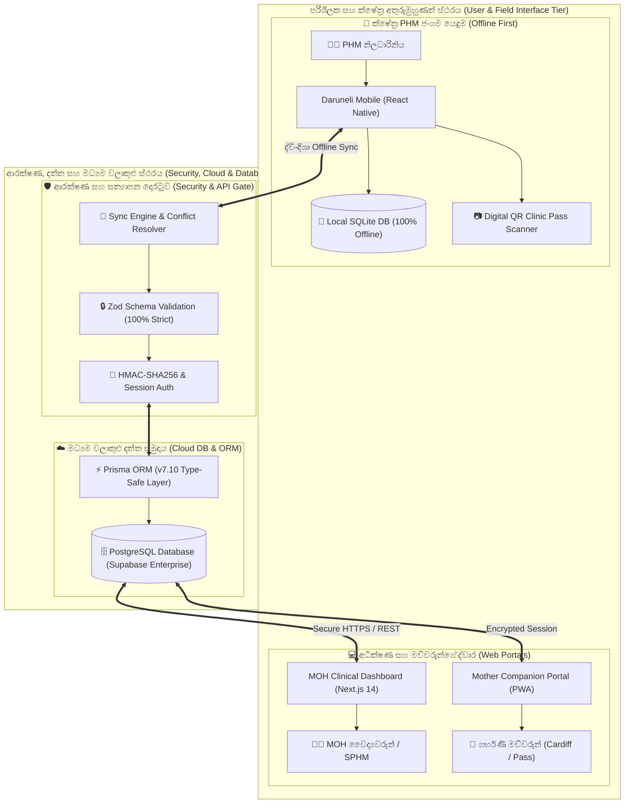
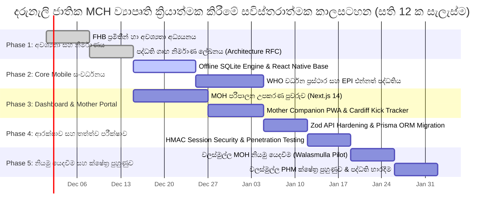

# ව්‍යාපෘති යෝජනාවලිය: දරුනැලි (Daruneli)
### ජාතික මාතෘ සහ ළමා සෞඛ්‍ය ඩිජිටල් තොරතුරු පද්ධතිය (National Maternal & Child Health Digital Platform)

| ක්ෂේත්‍රය (Field) | විස්තර (Details) |
| :--- | :--- |
| **ඉදිරිපත් කරන්නේ (Prepared For)** | සෞඛ්‍ය අමාත්‍යාංශය (Ministry of Health) / පවුල් සෞඛ්‍ය කාර්යාංශය (Family Health Bureau - FHB) / හම්බන්තොට ප්‍රාදේශීය සෞඛ්‍ය සේවා අධ්‍යක්ෂ කාර්යාලය (RDHS Hambantota) |
| **යෝජිත නියමු කලාපය (Pilot Region)** | **වලස්මුල්ල සෞඛ්‍ය වෛද්‍ය නිලධාරී (MOH) කොට්ඨාසය සහ වලස්මුල්ල මූලික රෝහල් කලාපය (Walasmulla MOH & Base Hospital Area)** |
| **ඉදිරිපත් කළේ (Prepared By)** | බිට්ගාඩ් පුද්ගලික සමාගම (Bitgard Pvt Ltd) — ඩිජිටල් සෞඛ්‍ය විසඳුම් අංශය |
| **දිනය (Date)** | 2026-11-24 |
| **ලේඛන අනුවාදය (Version)** | 1.1 (නියමු ව්‍යාපෘති යෝජනාවලිය — වලස්මුල්ල කලාපය / Walasmulla Pilot Edition) |
| **තත්ත්වය (Status)** | Proposed |

---

## 1. විධායක සාරාංශය (Executive Summary)

ශ්‍රී ලංකාවේ ප්‍රශංසනීය ප්‍රාථමික සෞඛ්‍ය සේවා ජාලය තවදුරටත් ශක්තිමත් කරමින්, පවුල් සෞඛ්‍ය සේවා නිලධාරිනියන් (PHM) සහ සෞඛ්‍ය වෛද්‍ය නිලධාරී (MOH) කාර්යාල මුහුණ දෙන සාම්ප්‍රදායික කඩදාසි ලේඛන (H512 මාතෘ වාර්තාව, H544 ළමා සංවර්ධන වාර්තාව - CHDR, H509 ලේඛන) ආශ්‍රිත ප්‍රමාදයන්, දත්ත අස්ථානගතවීම් සහ ග්‍රාමීය සන්නිවේදන බාධාවන් නිරාකරණය කිරීම සඳහා **"දරුනැලි (Daruneli)"** ජාතික ඩිජිටල් වේදිකාව යෝජනා කරනු ලැබේ.

මෙම පද්ධතිය 100% නොබැඳිව ක්‍රියාත්මක විය හැකි (Offline-First) ක්ෂේත්‍ර ජංගම යෙදුමකින් (React Native Expo + SQLite), තත්‍ය කාලීන MOH සායනික හා පරිපාලන උපකරණ පුවරුවකින් (Next.js 14 + PostgreSQL + Prisma ORM) සහ මව්වරුන් සවිබලගන්වන PWA වෙබ් ද්වාරයකින් (Mother Companion Portal) සමන්විත වේ. මාතෘ අධි අවදානම් (Red/Yellow risk tiers) සහ ළමා මන්දපෝෂණ තත්ත්වයන් කල්තියා හඳුනාගැනීම, ඩිජිටල් සායනික QR හැඳුනුම්පත් (Digital Clinic Pass) මගින් සායනික පොත් අස්ථානගතවීම වැළැක්වීම සහ දැඩි දත්ත ආරක්ෂණ ක්‍රමවේද (Zod validations & HMAC security) මෙමගින් තහවුරු කෙරේ.

මෙම ව්‍යාපෘතියේ ප්‍රථම නියමු අදියර (Phase 5 Pilot Deployment) **හම්බන්තොට දිස්ත්‍රික්කයේ වලස්මුල්ල සෞඛ්‍ය වෛද්‍ය නිලධාරී (MOH) කොට්ඨාසය සහ වලස්මුල්ල මූලික රෝහල් කලාපය (Walasmulla Base Hospital Area)** කේන්ද්‍ර කරගනිමින් සති 12 ක සැලැස්මක් යටතේ ක්‍රියාත්මක කිරීමට යෝජිත අතර, සෞඛ්‍ය බලධාරීන්ගේ නිල අනුමැතිය සඳහා මෙම විධායක ලේඛනය මෙයින් ඉදිරිපත් කෙරේ.

---

## 2. ගැටලු ප්‍රකාශය සහ පසුබිම (Problem Statement & Background)

ශ්‍රී ලංකාව දකුණු ආසියානු කලාපයේ අඩුම මාතෘ සහ ළදරු මරණ අනුපාතයක් වාර්තා කරන රටක් වුවද, පවතින අතින් ලියන ලද කඩදාසි පදනම් කරගත් ක්‍රියාවලිය හේතුවෙන් නවීන ඩිජිටල් සෞඛ්‍ය යුගයේ පහත දැක්වෙන තීරණාත්මක අභියෝග මතුව ඇත:

### 2.1 භෞතික ලේඛන භාවිතයේ පවතින සීමාවන් (Physical Records Bottlenecks)
- ක්ෂේත්‍ර නිලධාරිනියන්ට H512, CHDR, H509 ඇතුළු බරැති පොත්පත් රැසක් ක්ෂේත්‍ර චාරිකා වලදී රැගෙන යාමට සිදුවීම.
- ස්වාභාවික ආපදා, වැසි හෝ නිරන්තර භාවිතය නිසා පිටු ඉරී යාම, තෙත්වීම සහ අකුරු මැකී යාම.
- මවක් වෙනත් කොට්ඨාසයකට සංක්‍රමණය වූ විට (Relocation/Transfer) ඇයගේ පෙර සායනික ඉතිහාසය නව PHM නිලධාරිනියට කඩිනමින් ලබාගැනීමට නොහැකි වීම.

### 2.2 අන්තර්ජාල සබඳතා රහිත ග්‍රාමීය අභියෝග (Offline Fieldwork Challenges)
- ශ්‍රී ලංකාවේ බොහෝ ග්‍රාමීය සහ වතුකර ප්‍රදේශවල අන්තර්ජාල සංඥා (Cellular Connectivity) දුර්වල හෝ නොමැත.
- වර්තමානයේ පවතින බොහෝ වෙබ් පද්ධති අන්තර්ජාලය නොමැතිව ක්‍රියාත්මක කළ නොහැකි බැවින්, ක්ෂේත්‍රයේදී සෘජුවම දත්ත ඇතුළත් කිරීමට නොහැකි වී ද්විත්ව වැඩ (Double work) කිරීමට සිදුවේ.

### 2.3 අවදානම් තත්ත්වයන් කල්තියා හඳුනාගැනීමේ සහ වාර්තා කිරීමේ ප්‍රමාදය (Delayed Risk Escalation)
- ගර්භණී සමයේ අධික රුධිර පීඩනය (Preeclampsia), දියවැඩියාව (Gestational Diabetes) හෝ කලලයේ වර්ධනය අඩාලවීම් වැනි අධි අවදානම් සාධක හඳුනාගත් විට, එම තොරතුරු MOH වෛද්‍යවරයා වෙත ළඟාවීමට මීළඟ සායන වාරය (සති 2-4) තෙක් ප්‍රමාද වීම.
- ළදරුවන්ගේ වර්ධනය අඩාලවීම (Growth Faltering) හඳුනාගැනීමේ ප්‍රස්ථාර අතින් ඇඳීමේදී සිදුවන දෝෂ.

### 2.4 මව සහ සෞඛ්‍ය පද්ධතිය අතර සන්නිවේදන පරතරය (Mother Engagement Gap)
- මවට සායනික පොත අමතක වීම හෝ නැතිවීම නිසා සායන වලදී ප්‍රතිකාර ලබාදීම අපහසු වීම.
- දෛනික කලල චලන ගණනය (Cardiff Count-to-10 Kick Chart) නිසි පරිදි සටහන් නොකිරීම සහ අනතුරු ඇඟවීමේ ලක්ෂණ (Danger Signs) පිළිබඳ දැනුවත්භාවය අඩු වීම.

---

## 3. අරමුණු සහ සාර්ථකත්ව නිර්ණායක (Objectives & Success Criteria)

| අංකය | ව්‍යාපෘති අරමුණ (Objective) | මූලික කාර්යසාධන දර්ශකය (Key Metric) | ඉලක්කගත අගය (Target) | සත්‍යාපන ක්‍රමවේදය (Verification Method) |
| :---: | :--- | :--- | :---: | :--- |
| **OBJ-1** | ක්ෂේත්‍ර දත්ත සටහන් කිරීමේ කාලය අවම කිරීම | නිලධාරිනියකගේ දෛනික ලිපි ලේඛන කාලය | **70% කින් අඩු කිරීම** | ක්ෂේත්‍ර කාල නිරීක්ෂණ විගණනය (Time-motion study) |
| **OBJ-2** | 100% නොබැඳි ක්‍රියාකාරීත්වය තහවුරු කිරීම | අන්තර්ජාලය නොමැතිව ක්‍රියාත්මක වීම සහ Sync වීම | **0% දත්ත හානිය** | Offline field test & conflict-free sync verification |
| **OBJ-3** | අධි අවදානම් තත්ත්වයන් කල්තියා දැනුම්දීම | Red/Yellow අවදානම් MOH වෙත වාර්තා වන වේගය | **පැය 2 ක් ඇතුළත** | Automated system audit logs & timestamp verification |
| **OBJ-4** | ළමා එන්නත් සහ පෝෂණ අධීක්ෂණය නිවැරදි කිරීම | EPI එන්නත් කාලසටහන් හා වර්ධන ප්‍රස්ථාර ආවරණය | **98%+ නිරවද්‍යතාව** | Child Immunization & WHO Growth Chart verification |
| **OBJ-5** | මව්වරුන් ඩිජිටල් ලෙස සවිබලගැන්වීම | Mother Companion Portal සහ QR Pass භාවිතය | **90%+ මව්වරුන්** | Active PWA logins & Digital Clinic Pass scan logs |

---

## 4. යෝජිත තාක්ෂණික විසඳුම සහ නිර්මාණ ප්‍රවේශය (Proposed Solution & Architecture)

"දරුනැලි" පද්ධතිය ස්ථර තුනකින් (Three-tier Architecture) සමන්විත වන පරිදි නවීන, පරිශීලක-හිතකාමී සහ ඉහළ කාර්යසාධනයක් සහිත තාක්ෂණික මෙවලම් උපයෝගී කරගනිමින් නිර්මාණය කර ඇත:

### 4.1 ක්ෂේත්‍ර PHM ජංගම යෙදුම (Field Mobile App)
- **තාක්ෂණය:** React Native (Expo SDK 58), Local SQLite (`expo-sqlite`), NativeWind TailwindCSS.
- **Offline-First නිර්මාණය:** දුරස්ථ ක්ෂේත්‍රයේදී අන්තර්ජාලය නොමැතිව මව්වරුන්, සායනික සටහන්, එන්නත් සහ ළමා වර්ධන දත්ත 100% ක් සුරැකේ. අන්තර්ජාලය ලැබුණු වහාම පසුබිමෙන් සමමුහුර්ත (Background Sync) වේ.
- **ඩිජිටල් සායනික ස්කෑනරය (Digital Clinic QR Scanner):** මවගේ හෝ දරුවාගේ QR කේතය ක්ෂණිකව ස්කෑන් කර, භෞතික පොත නොමැති වුවද සම්පූර්ණ සායනික ඉතිහාසය ලබාගත හැක.
- **ත්‍රෛභාෂා සහාය (Tri-lingual i18n):** සිංහල, தமிழ் සහ English භාෂා ත්‍රිත්වයෙන්ම ක්‍රියාත්මක වේ.

### 4.2 MOH පරිපාලන සහ සායනික උපකරණ පුවරුව (Supervision Dashboard)
- **තාක්ෂණය:** Next.js 14 App Router, React 18, TailwindCSS, Recharts.
- **අවදානම් වර්ගීකරණය (Automated Maternal Risk Triaging):** රතු (Red - High Risk), කහ (Yellow - Moderate Risk), සහ කොළ (Green - Normal) ලෙස මව්වරුන් ස්වයංක්‍රීයව ශ්‍රේණිගත කර MOH වෛද්‍යවරයාට ප්‍රමුඛතා පදනමින් සායන පැවැත්වීමට මගපෙන්වයි.
- **භෞමික සිතියම්ගත කිරීම සහ ස්ථාන මාරු (GIS & Family Transfers):** නිවෙස් වල GPS ඛණ්ඩාංක සටහන් කිරීම, Google Maps මගින් නිවාස වෙත ගමන් මාර්ග බැලීම සහ කොට්ඨාස අතර පවුල් මාරුවීම් (Transfers) අධීක්ෂණය.

### 4.3 මව්වරුන්ගේ ඩිජිටල් සහායක ද්වාරය (Mother Companion Portal PWA)
- **තාක්ෂණය:** Progressive Web Application (PWA), Mobile-responsive, Add-to-Homescreen support.
- **සුරක්ෂිත පිවිසුම:** ජාතික හැඳුනුම්පත් අංකය සහ ඉලක්කම් 4 රහස්‍ය PIN අංකය මගින් හෝ PHM නිලධාරිනිය ලබාදෙන 6-අක්ෂර ආරාධනා කේතය (Invite Code) මගින් සරලව ලියාපදිංචි වීම.
- **කාඩිෆ් කලල චලන ගණකය (Cardiff Count-to-10 Kick Tracker):** දිනපතා කලල චලන 10 සටහන් කිරීම. චලන අඩුවීමක් හඳුනාගත් වහාම මවට ක්ෂණික රතු අනතුරු ඇඟවීම් (Emergency Alerts) නිකුත් කිරීම.
- **ඩිජිටල් සායනික හැඳුනුම්පත (Digital Clinic Pass):** භෞතික සායනික පොත අස්ථානගත වුවද, ජංගම දුරකථනයේ ඇති QR කේතය සායනයේදී පෙන්වා සේවා ලබාගැනීමේ හැකියාව.

### 4.4 දත්ත සුරක්ෂිතතාවය සහ වලංගුභාවය (Security & Data Integrity)
- **Zod Validation Framework:** ජංගම යෙදුමේ ආකෘති පත්‍ර (Forms) සහ Backend API endpoints සියල්ල Zod මගින් සත්‍යාපනය කර ද්වේෂසහගත හෝ වැරදි දත්ත ඇතුළත් වීම 100% වළක්වා ඇත.
- **Prisma ORM (v7.10):** PostgreSQL දත්ත සමුදාය සමග type-safe ගනුදෙනු සහ row-level audit logging.
- **ගුප්තකේතනය (HMAC-SHA256):** මව්වරුන්ගේ දත්ත සැසි (Sessions) සහ රහස්‍ය තොරතුරු ඉහළම ආරක්ෂණ ප්‍රමිතීන්ට අනුව ගුප්තකේතනය කර ඇත.

---

## 5. කාර්ය පථය (Scope of Work)

### ඇතුළත් අංග (In Scope)
1. **PHM ජංගම යෙදුම සංවර්ධනය:** මව්වරුන් ලියාපදිංචිය, පූර්ව ප්‍රසව සායන (Antenatal Visits), පශ්චාත් ප්‍රසව පරීක්ෂණ (Postnatal Visits), ළමා ලියාපදිංචිය, WHO වර්ධන ප්‍රස්ථාර සහ EPI එන්නත් පද්ධතිය.
2. **MOH පරිපාලන වෙබ් පද්ධතිය:** MOH කොට්ඨාස කළමනාකරණය, නිලධාරී පරිශීලක පාලනය (RBAC), අවදානම් අධීක්ෂණය, මාරුවීම් සහ සංඛ්‍යාලේඛන වාර්තා.
3. **Mother Companion Portal:** රහස්‍ය PIN පිවිසුම, ගර්භණී සති ප්‍රගතිය, සායන දින දර්ශනය, Cardiff චලන සටහන සහ ඩිජිටල් QR සායනික කාඩ්පත.
4. **දත්ත සමුදාය සහ ආරක්ෂණ යටිතල පහසුකම්:** Supabase PostgreSQL සැකසුම, Prisma ORM ඒකාබද්ධතාවය, Zod validation, සහ Offline Sync ගෘහ නිර්මාණය.
5. **වලස්මුල්ල නියමු යෙදවීම සහ පරිශීලක පුහුණුව:** වලස්මුල්ල සෞඛ්‍ය වෛද්‍ය නිලධාරී (MOH) කාර්යාලය, වලස්මුල්ල මූලික රෝහලේ මාතෘ සායන ඒකකය සහ වලස්මුල්ල බලප්‍රදේශයේ PHM නිලධාරිනියන් සඳහා සජීවී පද්ධති ස්ථාපනය, පුහුණු අත්පොත් සහ ක්ෂේත්‍ර නියමු අධීක්ෂණය.

### බැහැර කර ඇති අංග (Out of Scope)
1. රෝහල් අභ්‍යන්තර නේවාසික වාට්ටු කළමනාකරණය (In-patient hospital ward management).
2. ශල්‍යාගාර උපලේඛනගත කිරීම් (Operating theatre scheduling).
3. ජාතික මට්ටමේ මධ්‍යම ඖෂධ ප්‍රසම්පාදන සැපයුම් දාම කළමනාකරණය (National central medical supplies ERP).

---

## 6. ප්‍රධාන ප්‍රතිදානයන් සහ ක්‍රියාත්මක කිරීමේ කාලරාමුව (Timeline & Deliverables)

ව්‍යාපෘතිය සති 12 ක අදියර 5 කින් ක්‍රියාත්මක කිරීමට සැලසුම් කර ඇත:

| අදියර (Phase) | ප්‍රධාන ප්‍රතිදානයන් (Key Deliverables) | වගකිවයුතු භූමිකාව (Owner / Role) | ආරම්භය (Start) | ඉලක්කගත දිනය (Target) |
| :--- | :--- | :--- | :---: | :---: |
| **Phase 1: මූලික සැලසුම්කරණය (Discovery & Design)** | පද්ධති ගෘහ නිර්මාණ ලේඛනය (Architecture Blueprint), FHB මාතෘ සටහන් ප්‍රමිතීන් අධ්‍යයනය. | Solution Architect / Health Informatics Lead | Week 1 | Week 2 |
| **Phase 2: ජංගම යෙදුම සහ නොබැඳි පදනම (Core Mobile & Offline Build)** | React Native Expo Mobile App, Local SQLite schema, Offline-first sync engine. | Lead Mobile Engineer | Week 3 | Week 5 |
| **Phase 3: MOH Dashboard සහ Mother PWA සංවර්ධනය** | Next.js 14 Web Dashboard, Mother Companion PWA, Digital QR Pass Generator. | Fullstack Web Engineer | Week 6 | Week 8 |
| **Phase 4: ආරක්ෂාව, වලංගුකරණය සහ විගණනය** | Zod API hardening, Prisma ORM migration, HMAC security, E2E Testing. | QA & Security Engineer | Week 9 | Week 10 |
| **Phase 5: නියමු ක්ෂේත්‍ර යෙදවීම සහ පුහුණුව (Walasmulla Pilot)** | වලස්මුල්ල MOH කොට්ඨාසය සහ වලස්මුල්ල මූලික රෝහල ආශ්‍රිත සජීවී නියමු යෙදවීම, වලස්මුල්ල PHM නිලධාරිනී පුහුණු වැඩමුළු, පරිශීලක ප්‍රතිපෝෂණ විගණනය. | Project Manager & Implementation Lead | Week 11 | Week 12 |

---

## 7. සම්පත් සහ අයවැය ඇස්තමේන්තුව (Resource & Budget Estimate)

| ප්‍රවර්ගය (Category) | විස්තරය (Description) | ප්‍රමාණය / කාලය (Effort / Units) | ඇස්තමේන්තුගත මුදල (LKR) |
| :--- | :--- | :---: | :---: |
| **මෘදුකාංග ඉංජිනේරු ශ්‍රමය (Engineering & Core Development)** | Mobile (Expo/React Native), Web (Next.js), Data Engine (Prisma/PostgreSQL), Security & Testing | සති 12 (ඉංජිනේරුවන් 5 දෙනෙකුගෙන් යුත් කණ්ඩායම) | රු. 3,850,000 |
| **වලාකුළු යටිතල පහසුකම් (Cloud & Security Infrastructure)** | Supabase Managed PostgreSQL, Cloud Hosting, SSL, Backup & Storage (පළමු වසර සඳහා) | මාස 12 ක සත්කාරකත්වය | රු. 480,000 |
| **නියමු ක්ෂේත්‍ර පුහුණුව සහ සම්පත් (Walasmulla Pilot & Training)** | වලස්මුල්ල MOH කොට්ඨාසයේ PHM නිලධාරිනියන් සහ වලස්මුල්ල මූලික රෝහලේ සායනික කාර්ය මණ්ඩලය සඳහා මුද්‍රිත අත්පොත්, පුහුණු සැසි | වලස්මුල්ල MOH බලප්‍රදේශය (නියමු) | රු. 350,000 |
| **තාක්ෂණික සහාය සහ නඩත්තුව (Year 1 Support & SLA)** | දෝෂ නිවැරදි කිරීම් (Bug fixes), OS updates ගැළපුම, 24/7 හදිසි තාක්ෂණික සහාය | මාස 12 | රු. 720,000 |
| **මුළු ඇස්තමේන්තුව (Total Proposed Investment)** | | | **රු. 5,400,000** |

> [!NOTE]
> **ලාභ නොලබන සමාජ සත්කාරක මූලධර්මය (Non-Profit / Free Public Service):**
> මෙම පද්ධතිය ශ්‍රී ලංකාවේ සියලුම ගර්භණී මව්වරුන්, දරුවන්, පවුල් සෞඛ්‍ය සේවා නිලධාරිනියන් (PHM) සහ MOH කාර්ය මණ්ඩලය වෙත කිසිදු අයකිරීමකින් තොරව (100% Free of Charge) සමාජ සත්කාරයක් ලෙස පිරිනමනු ලැබේ. ඉහත දක්වා ඇති ඇස්තමේන්තුගත මුදල මෘදුකාංග සංවර්ධනය, සුරක්ෂිත වලාකුළු සත්කාරක වියදම් (Cloud Hosting) සහ ක්ෂේත්‍ර පුහුණුව සඳහා වන මූලික ආයෝජනය වන අතර, එය රාජ්‍ය ප්‍රදාන (Grants), දේශීය/විදේශීය ආධාර හෝ ආයතනික සමාජ වගකීම් (CSR) අරමුදල් මගින් ආවරණය කර ගැනීමට අපේක්ෂිතය.

*සටහන: ක්ෂේත්‍ර නිලධාරිනියන් සඳහා ටැබ්ලට් හෝ ජංගම දුරකථන දෘඩාංග (Hardware Tablets) රජය හෝ අදාළ ආධාරක සංවිධාන විසින් සපයනු ඇතැයි උපකල්පනය කෙරේ.*

---

## 8. අවදානම්, උපකල්පන සහ අවම කිරීමේ ක්‍රමෝපායන් (Risks & Mitigations)

### ප්‍රධාන උපකල්පන (Key Assumptions)
1. ක්ෂේත්‍ර නිලධාරිනියන් සතුව ඇන්ඩ්‍රොයිඩ් (Android 9.0 හෝ ඊට ඉහළ) පහසුකම් සහිත ස්මාර්ට් ජංගම දුරකථනයක් හෝ ටැබ්ලට් පරිගණකයක් පවතී.
2. සෞඛ්‍ය අමාත්‍යාංශය සහ පවුල් සෞඛ්‍ය කාර්යාංශය විසින් නියමු කොට්ඨාසය සඳහා අවශ්‍ය නිල අනුමැතිය සහ සම්බන්ධීකරණය ලබාදෙනු ඇත.

### අවදානම් ලේඛනය (Risk Register)

| අවදානම (Risk Description) | සම්භාවිතාව (Likelihood) | බලපෑම (Impact) | අවම කිරීමේ ක්‍රමෝපාය (Mitigation Strategy) |
| :--- | :---: | :---: | :--- |
| **1. දුරස්ථ ප්‍රදේශවල සන්නිවේදන විසන්ධිවීම්** (Loss of cellular network connectivity) | High | Low | **Offline-First SQLite Architecture:** සියලුම දත්ත ප්‍රථමයෙන් දුරකථනයේම තැන්පත් වන අතර අන්තර්ජාලය නොමැතිව දින ගණනාවක් වුවද කිසිදු බාධාවකින් තොරව ක්‍රියා කළ හැක. |
| **2. ක්ෂේත්‍ර කාර්ය මණ්ඩලයේ තාක්ෂණික හුරුපුරුදු බව** (User adoption among field PHMs) | Medium | Medium | සාම්ප්‍රදායික H512 පොතේ පිරිසැලසුමට (Layout) සමානවන පරිදි අතුරුමුහුණත සිංහල සහ දෙමළ භාෂාවෙන් නිර්මාණය කිරීම සහ ප්‍රායෝගික පුහුණු වැඩමුළු පැවැත්වීම. |
| **3. සංවේදී සෞඛ්‍ය දත්තවල රහස්‍යභාවය** (Patient Health Data Security & Breach) | Low | High | Zod schema validation මගින් ද්වේෂසහගත දත්ත වැළැක්වීම, Argon2/HMAC ගුප්තකේතනය සහ Role-Based Access Control (RBAC) මගින් දත්ත අවසර පාලනය කිරීම. |
| **4. දෘඩාංග ගැළපුම සහ බැටරි කාර්යක්ෂමතාව** (Low-end device performance & battery drain) | Medium | Medium | React Native හි සැහැල්ලු pure-native සංරචක භාවිතය, අනවශ්‍ය background processes සීමා කිරීම සහ අඳුරු මුහුණත (Dark Mode) සහාය ලබාදීම. |

---

## 9. මීළඟ පියවර සහ අනුමැතිය (Next Steps & Approval)

1. **යෝජනාවලිය සමාලෝචනය:** සෞඛ්‍ය අමාත්‍යාංශයේ සහ පවුල් සෞඛ්‍ය කාර්යාංශයේ තාක්ෂණික කමිටුව විසින් මෙම යෝජනාවලිය සමාලෝචනය කිරීම.
2. **නියමු කොට්ඨාසය තෝරාගැනීම:** මහරගම හෝ කොට්ටාව MOH කොට්ඨාසය නියමු ව්‍යාපෘතිය (Pilot Project) සඳහා නම් කිරීම.
3. **ගිවිසුම්ගත වීම සහ ආරම්භය (Kickoff):** පාර්ශ්වයන් අතර එකඟතාවයකට පැමිණ Phase 1 ආරම්භ කිරීම.

| පාර්ශ්වය (Party) | නම සහ තනතුර (Name & Title) | අත්සන (Signature) | දිනය (Date) |
| :--- | :--- | :--- | :---: |
| **සෞඛ්‍ය අමාත්‍යාංශය වෙනුවෙන්** | .................................................... | ....................................... | ...... / ...... / 2026 |
| **බිට්ගාඩ් (Pvt) Ltd වෙනුවෙන්** | ෂමීන් රූපසිංහ (Lead Architect, Bitgard) | ....................................... | ...... / ...... / 2026 |
